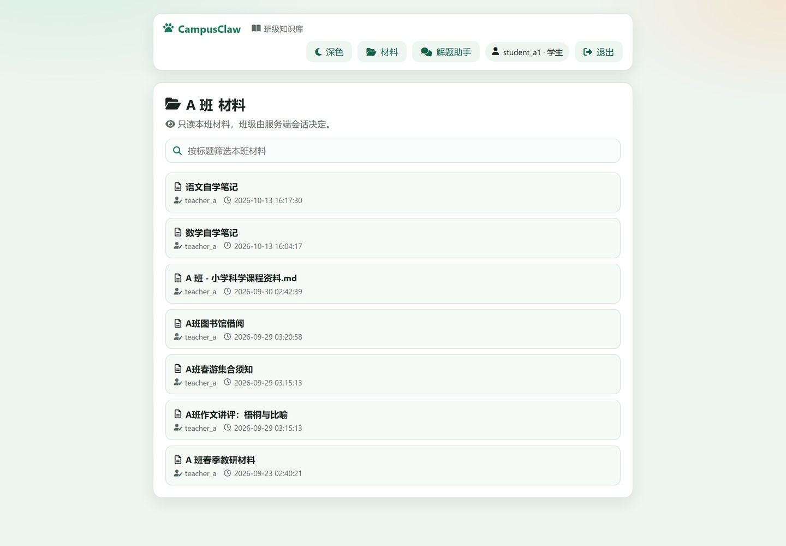
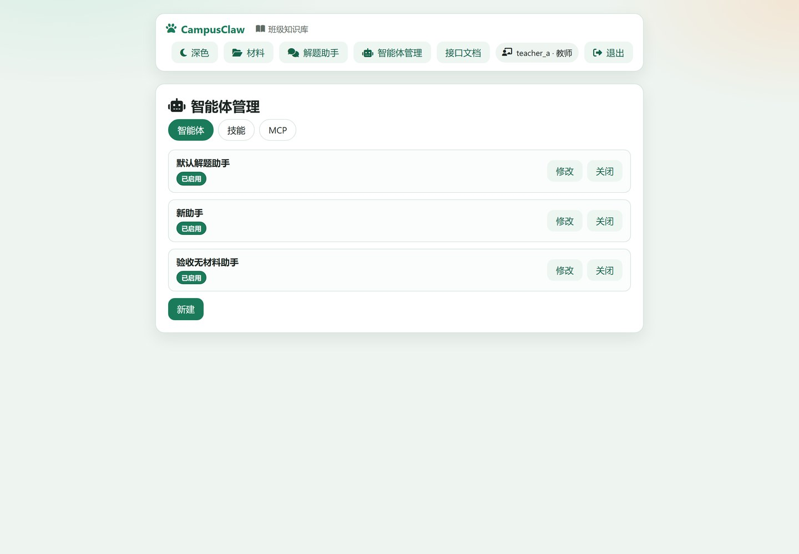
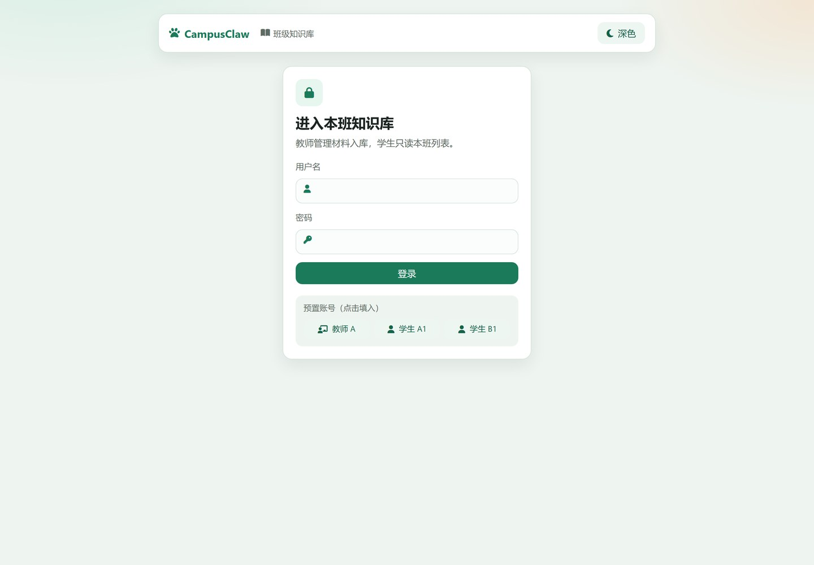
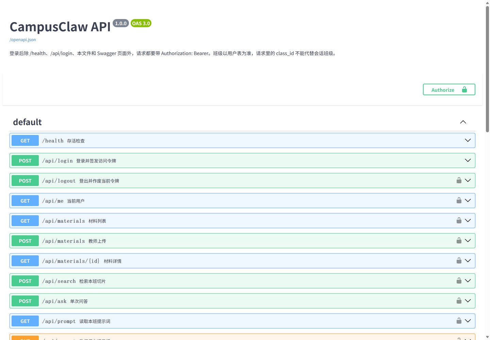
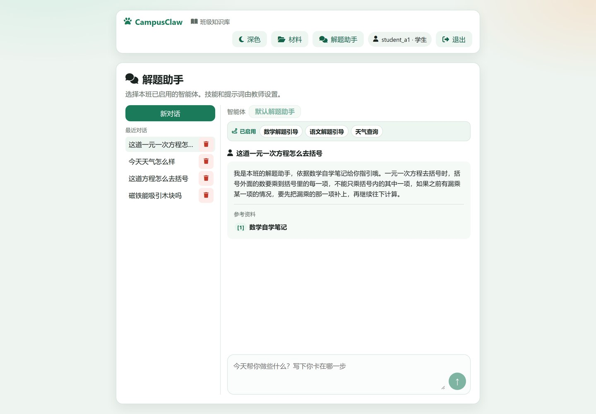
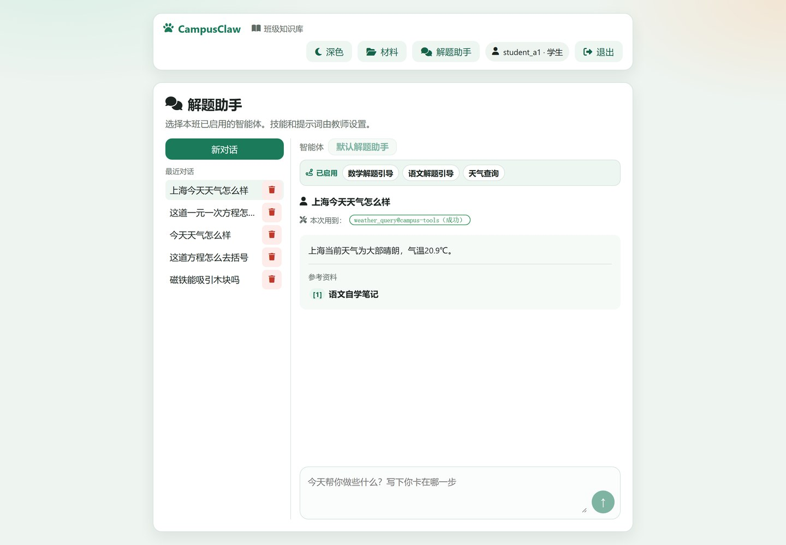
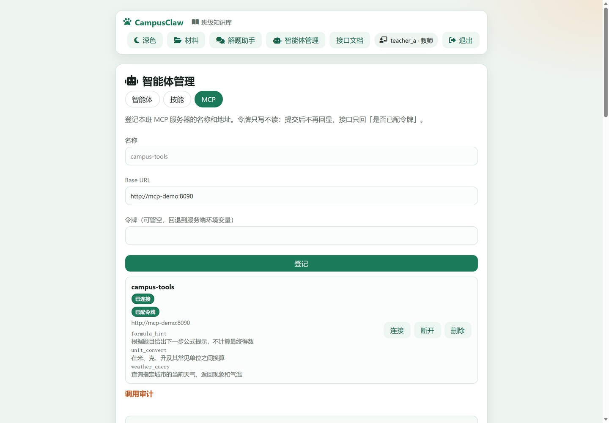
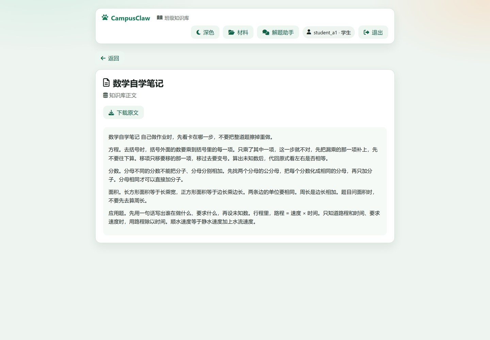

# CampusClaw 项目文档

> 更新：2026-10-21
> 启动步骤见 [README](../README.md)。各次变更的规约在 `openspec/changes/`。

---

## 目录

1. [项目概览](#1-项目概览)
2. [功能地图](#2-功能地图)
3. [系统架构](#3-系统架构)
4. [目录结构](#4-目录结构)
5. [快速开始](#5-快速开始)
6. [配置项参考](#6-配置项参考)
7. [数据模型](#7-数据模型)
8. [接口手册](#8-接口手册)
9. [核心链路](#9-核心链路)
10. [安全设计](#10-安全设计)
11. [前端](#11-前端)
12. [运维手册](#12-运维手册)

---

## 1. 项目概览

CampusClaw 是一个**按班级隔离的课程知识库 + 解题助手**。教师把本班材料入库，学生对着材料连续提问；回答以 SSE 逐段返回，命中材料时标出处，需要时还能调用教师登记的 MCP 工具。所有班级边界与角色权限都在服务端判定。

| 维度 | 内容 |
| --- | --- |
| 用户 | 教师、学生；两个预置班级（A 班、B 班） |
| 核心场景 | 上传材料 → 切片入库 → 混合检索 → 逐段生成回答（可带引用、可调工具） |
| 技术栈 | Go 1.22（API）+ React 18 / TypeScript / Vite（前端）+ MySQL 8.0 + Qdrant + Go（自建 MCP 服务）+ Nginx |
| 部署 | Docker Compose，只有 `web` 映射宿主机端口 |
| 鉴权 | HS256 JWT（`Authorization: Bearer`），`jti` 落库可即时吊销 |
| 明确不做 | 作业提交与批改、错题讲解、关怀式对话、异步队列、交叉编码器重排、把 Qdrant/MySQL/MCP 端口映射到宿主机 |

**设计取向**（贯穿全项目的三条）：

1. **服务端强制**：班级隔离与 RBAC 在服务端判定，前端隐藏按钮不构成保护。
2. **数据位与指令位分离**：上传材料、工具返回都是不可信数据，只进用户消息 / 工具消息，不进系统提示。
3. **失败局部化**：检索、工具、生成任一环失败，都不把整轮对话变成 500；工具是增益不是主路径。

---

## 2. 功能地图

### 2.1 学生

| 能力 | 入口 | 说明 |
| --- | --- | --- |
| 登录 / 退出 | `/login` | 令牌存 `sessionStorage`，退出即吊销 |
| 浏览本班材料 | `/` | 只能看到本班；按标题筛选 |
| 查看材料详情 / 原文 | `/m/:id` | 跨班按编号访问返回 404 |
| 解题助手 | `/ask` | 选择本班已启用的智能体并连续追问。还没有消息时可以更换智能体，已有消息后不能换。页面显示该智能体已启用的技能。回答框内只列出参考资料的序号和标题 |



*图 1　学生端材料列表：只列本班材料，顶部按标题检索*

学生**不能**改提示词、技能、智能体、MCP 服务器，也不能开关解题引导（服务端返回 403）。

### 2.2 教师

在学生全部能力之上：

| 能力 | 入口 | 说明 |
| --- | --- | --- |
| 上传 / 编辑 / 删除材料 | `/`、`/m/:id/edit` | 仅 `.txt` / `.md`；上传后自动切片入库 |
| 重切片 | 材料详情 | `auto` / `custom` / `hierarchy` 三种策略 |
| 智能体管理 | `/admin` | 名称（≤64 字）、角色提示词（≤2000 字）、绑定技能与材料、启用开关 |
| 技能文件 | `/admin` → 技能 | 「名称 / 适用条件 / 资料 / 工具 / 启用 + 正文」，班内名称唯一 |
| MCP 服务器 | `/admin` → MCP | 登记、连接并发现、断开、删除；查看工具名称与说明、最近调用记录 |
| 跨班查看 | 材料页班级切换 | 仅教师可切；检索与问答仍以会话班级为准 |



*图 2　教师端智能体管理：每个智能体可改角色提示词、绑定技能与材料、启用或停用*

### 2.3 对外接口

- `GET /health`：无需登录、不探活数据库，供容器健康检查。
- `/swagger/` 与 `/openapi.json`：静态接口文档，无需登录。
- `/api/*`：除 `login` 外都需要 Bearer 令牌。

---

## 3. 系统架构

### 3.1 组件

| 组件 | 镜像 / 构建 | 端口 | 职责 |
| --- | --- | --- | --- |
| `web` | `frontend/Dockerfile`（node 构建 → nginx） | 宿主 `${WEB_PORT}` → 80 | 静态资源、反向代理 `/api/`、关闭代理缓冲以支持 SSE |
| `api` | `backend/Dockerfile`（golang → alpine） | 8080（仅内网） | 业务 API、切片入库、检索、生成、MCP 编排 |
| `db` | `mysql:8.0` | 3306（仅内网） | 用户、材料、切片、会话、技能、审计 |
| `qdrant` | `qdrant/qdrant:v1.12.5` | 6333（仅内网） | 向量索引与检索 |
| `mcp-demo` | `mcp-server/Dockerfile` | 8090（仅内网） | 自建 MCP 工具服务：`initialize` / `tools/list` / `tools/call` |

### 3.2 部署拓扑

```
          宿主机
            │  只暴露 WEB_PORT
            ▼
    ┌───────────────┐
    │   web (nginx) │  静态资源 + /api/ 反向代理（proxy_buffering off）
    └───────┬───────┘
            │ compose 内网
            ▼
    ┌───────────────┐         ┌──────────────┐
    │  api (Go)     │───────▶│  db (MySQL)  │
    │               │───────▶│ qdrant       │
    │               │───────▶│ mcp-demo     │  Bearer 令牌
    └───────────────┘         └──────────────┘
            │
            │ HTTPS（容器出网）
            ▼
    课程网关 ai-gateway（chat/completions、embeddings）
```

### 3.3 一次普通请求

```
浏览器 ──Bearer──▶ nginx ──▶ api
                              ├─ token.Parse(SESSION_SECRET) 验签
                              ├─ 查 sessions + users：jti 未吊销、取 role/class_id
                              ├─ 业务处理（SQL / Qdrant / 网关）
                              └─ JSON 或 SSE 返回
```

**关键点**：角色与班级每请求从 `users` 表读取，不信任令牌里的声明；请求体里的 `class_id` 一律忽略（教师显式切班的上传/列表除外）。

### 3.4 启动与自举（`api` 启动序列）

1. `config.Load()`：校验必需环境变量（`SESSION_SECRET`、`DB_PASSWORD`、`DB_USER`、`DB_NAME`、`SEED_PASSWORD`）。
2. `store.Open()`：最多重试 40 次（每 2 秒）等待 MySQL。
3. `store.Init()`：幂等建表 → 容错补列 → 回填会话标题 → 写种子数据。
4. Qdrant 就绪等待 → `Ensure()` 按 `VECTOR_SIZE` 建/校验集合；维度变化则整体重建嵌入。
5. `Backfill()`：把 `pending` 切片补索引。
6. `ListenAndServe`。

整个过程体现在 `backend/cmd/server/main.go`。

---

## 4. 目录结构

```
Homework2/
├── backend/                     Go API
│   ├── cmd/server/main.go       启动入口
│   └── internal/
│       ├── config/              环境变量与 URL 拼接
│       ├── store/               建表、迁移、种子
│       ├── token/               HS256 签发与校验
│       ├── server/              HTTP 处理器（路由、鉴权、材料、会话、MCP）
│       ├── tutor/               消息组装、技能路由、SSE 生成与工具循环
│       ├── chat/                非流式问答
│       ├── retrieve/            关键词 / 向量 / 混合检索
│       ├── chunker/             三种切片策略
│       ├── indexx/              切片入库与向量写入
│       ├── embedder/            嵌入客户端
│       ├── qdrant/              向量库客户端
│       ├── skillfile/           技能文件解析与校验
│       └── mcpclient/           MCP JSON-RPC 客户端
├── frontend/                    React + Vite + nginx
│   ├── src/pages/               Login / Materials / Detail / Edit / Ask / Admin
│   ├── src/api.ts               接口封装与 SSE 解帧
│   ├── public/swagger/          Swagger UI 静态页
│   └── public/openapi.json      接口描述（手工维护）
├── mcp-server/                  自建 MCP 服务（3 个工具）
├── apitest/                     接口测试，需要 Compose 已启动
├── scripts/                     verify_api、verify_scenarios、verify_tutor
├── openspec/changes/            各次变更的 proposal、design、tasks
├── docs/                        本文、界面截图与对话链路验证报告
├── docker-compose.yml
├── start.ps1                    一键构建并启动
├── .env.example
└── README.md / AGENTS.md
```

---

## 5. 快速开始

### 5.1 前置

- Docker Desktop（Compose v2）
- 能访问课程网关 `https://ai-gateway.devops.hello1023.com/`

### 5.2 配置

```powershell
Copy-Item .env.example .env
```

至少要填：`SESSION_SECRET`、`DB_PASSWORD`、`MYSQL_ROOT_PASSWORD`、`SEED_PASSWORD`、`EMBEDDING_API_KEY`、`CHAT_API_KEY`、`MCP_AUTH_TOKEN`。

> 密钥只放本机 `.env`，不进源码、不进镜像、不提交 Git。`.env` 已在 `.gitignore` 中。

### 5.3 启动

已有 `.env` 时，在仓库根目录执行：

```powershell
.\start.ps1
```

脚本确认 Docker 正在运行后，执行 `docker compose up --build -d --wait`，并打印登录地址。没有 `.env` 时，它会从 `.env.example` 复制一份并停下来，等密钥填好后再运行。也可以直接：

```powershell
docker compose up -d --build
docker compose ps
```

启动顺序由 healthcheck 保证：`db` → `api` → `web`；`qdrant`、`mcp-demo` 与 `api` 同网络。`api` 首次启动需要建表、写种子、等 Qdrant，健康检查给了 180 秒起步时间。

### 5.4 预置账号

口令来自 `.env` 的 `SEED_PASSWORD`（库里只存 bcrypt）：

| 用户名 | 角色 | 班级 |
| --- | --- | --- |
| `teacher_a` | 教师 | A 班 |
| `student_a1` | 学生 | A 班 |
| `student_b1` | 学生 | B 班 |

预置数据：两个班、两条标题可区分的材料、每班一条默认角色提示词、一个「默认解题助手」。种子技能是「数学解题引导」（工具 `knowledge_search`，资料为「数学」）和「天气查询」（工具 `weather_query@campus-tools`，资料留空），两份都绑定到默认解题助手。



*图 3　登录页：口令来自 `.env` 的 `SEED_PASSWORD`，登录成功后令牌存入 `sessionStorage`*

### 5.5 冒烟验证

```powershell
# 健康检查（无需登录、不碰数据库）
curl http://localhost:8080/health

# 接口测试（需要栈在跑）
python apitest/run_all.py

# 对话、检索与班级隔离
python scripts/verify_tutor.py
python scripts/verify_api.py
python scripts/verify_scenarios.py
```

服务器端单元测试（不需要栈）：

```powershell
cd backend
go vet ./...
go test ./...
```

---

## 6. 配置项参考

| 变量 | 默认 | 必需 | 说明 |
| --- | --- | --- | --- |
| `SESSION_SECRET` | 无 | ✅ | JWT HS256 签名密钥 |
| `DB_HOST` / `DB_PORT` | `db` / `3306` | | MySQL 地址 |
| `DB_USER` / `DB_PASSWORD` / `DB_NAME` | 无 | ✅ | 业务库账号 |
| `MYSQL_ROOT_PASSWORD` | 无 | ✅ | 仅 `db` 容器初始化用 |
| `SEED_PASSWORD` | 无 | ✅ | 预置账号口令（bcrypt 入库） |
| `MAX_UPLOAD_BYTES` | `2097152` | | 单个上传上限（2 MiB） |
| `UPLOAD_DIR` | `/data/uploads` | | 容器内上传目录（Compose 卷 `uploads`） |
| `SESSION_TTL_HOURS` | `24` | | 令牌有效期 |
| `LOGIN_FAIL_LIMIT` / `LOGIN_LOCK_SECONDS` | `8` / `60` | | 按「用户名+IP」失败锁定 |
| `QDRANT_URL` | `http://qdrant:6333` | | 向量库地址 |
| `EMBEDDING_DIM` / `VECTOR_SIZE` | `2048` / `384` | | 向量维度；`EMBEDDING_DIM` 优先 |
| `EMBEDDING_BASE_URL` / `EMBEDDING_API_KEY` / `EMBEDDING_MODEL` | 课程网关 / 空 / `course-embedding` | | 嵌入服务 |
| `CHAT_BASE_URL` / `CHAT_API_KEY` / `CHAT_MODEL` | 课程网关 / 空 / `course-chat` | | 对话网关；未配置时走本地确定性回答 |
| `MCP_AUTH_TOKEN` | 空 | | 全局 MCP 令牌；服务器可各自覆盖 |
| `MCP_MAX_ROUNDS` | `3` | | 一条提问最多几轮工具往返 |
| `MCP_MAX_CALLS` | `4` | | 一条提问累计最多几次工具调用 |
| `WEB_PORT` | `8080` | | 宿主端口 |

> Base URL 可以写 `https://host` 或 `https://host/v1`，`config.OpenAIURL` 统一补成 `/v1/chat/completions` 这类路径。

---

## 7. 数据模型

### 7.1 关系概览

```
classes ─┬─ users ──────────────┬─ sessions
         ├─ materials ── knowledge_entries ── knowledge_chunks
         ├─ class_prompts
         ├─ class_skills            （旧：单一「解题引导」开关）
         ├─ class_agents ─┬─ class_agent_skill_files ─ skill_files
         │                ├─ class_agent_skills（旧键值绑定）
         │                └─ class_agent_materials ─ materials
         ├─ conversations ── conversation_messages
         ├─ mcp_servers ── mcp_tools
         └─ mcp_audit
```

### 7.2 表清单

| 表 | 作用 | 关键列 / 约束 |
| --- | --- | --- |
| `classes` | 班级 | `name` 唯一 |
| `users` | 用户 | `username` 唯一，`role ENUM(teacher,student)`，`class_id` |
| `sessions` | 令牌吊销表 | `id`=JWT `jti`，`expires_at` |
| `materials` | 材料 | `title`、`class_id`、`file_path`、`uploaded_by` |
| `knowledge_entries` | 材料全文 | 一条材料一行 |
| `knowledge_chunks` | 切片 | `chunk_text`（ngram 全文索引）、`char_start/end`、`index_status`、`strategy` |
| `class_prompts` | 班级提示词（旧） | 每班一行 |
| `class_skills` | 班内技能开关（旧） | `(class_id, skill_key)` 主键 |
| `skill_files` | 技能文件 | 班内 `name` 唯一；`trigger_text`、`subject`、`tool`、`enabled`、`body`、`source` |
| `class_agents` | 智能体 | 班内 `name` 唯一；`prompt`、`enabled` |
| `class_agent_skill_files` | 智能体↔技能 | 复合主键，级联删除 |
| `class_agent_materials` | 智能体↔材料 | 复合主键，级联删除 |
| `conversations` | 会话 | `user_id`、`class_id`、`agent_id`、`title`、`updated_at` |
| `conversation_messages` | 消息 | `role(user/assistant)`、`content`、`citations_json`、`prompt_snapshot`、`skill_enabled`、`skill_name` |
| `mcp_servers` | MCP 登记 | 班内 `name` 唯一；`base_url`、`token`（只写不读）、`connected` |
| `mcp_tools` | 发现结果快照 | `(server_id,name)` 主键；`description`、`input_schema` |
| `mcp_audit` | 调用审计 | `tool_ref`、`status`、`user_id`、`conversation_id`、`round_no`、`created_at` |

历史遗留、当前不参与业务判定：`lectures`、`homework`、`assistants`、`skills`、`class_agent_skills`、`class_skills`。

### 7.3 迁移策略

没有独立迁移框架，`store.Init()` 采用「幂等建表 + 容错补列」：

- `CREATE TABLE IF NOT EXISTS`：重复启动不报错、不重建已有表。
- `ALTER TABLE ... ADD COLUMN`：捕获 `Duplicate column` 后忽略，用于旧库平滑升级。
- `backfillTitles()`：把历史会话空标题按首问前 24 字补齐。

升级后**只能前进不能回退**：新增列都带默认值，旧代码可继续读。

### 7.4 种子数据

只在对应表为空/缺失时写入：

- 班级：`A 班`、`B 班`。
- 用户：三个预置账号，口令 bcrypt。
- 材料：`A 班春季教研材料（数学）`、`B 班春季教研材料（数学）`。标题含「数学」，与「数学解题引导」的资料字段一致。
- 提示词 / 技能 / 智能体：每班一份默认角色、一个「默认解题助手」，以及「数学解题引导」「天气查询」两份技能，并绑定到该助手。

---

## 8. 接口手册

### 8.1 通用约定

- 认证：`Authorization: Bearer <jwt>`；缺失或过期 → `401 {"error":"unauthorized"}`。
- 班级：以数据库中的 `users.class_id` 为准；请求体里的 `class_id` 不生效。
- 内容类型：普通接口 `application/json`；上传用 `multipart/form-data`；对话用 `text/event-stream`。
- 跨班与不存在：返回**完全一致**的 `404 {"error":"not_found"}`，避免用状态码探测资源。
- 错误体统一为 `{"error":"<code>"}`，`mcp_unavailable` 另带可读 `message`。



*图 4　`/swagger/`：静态 Swagger UI，按 `/openapi.json` 列出接口与鉴权要求*

### 8.2 接口表

#### 基础与认证

| 方法 | 路径 | 角色 | 说明 |
| --- | --- | --- | --- |
| GET | `/health` | 公开 | 返回 `{"status":"ok"}`，不查库 |
| POST | `/api/login` | 公开 | 入参 `{username,password}`；成功返回 `{ok,role,class_id,token}` |
| POST | `/api/logout` | 公开（带令牌则吊销） | 删除当前 `jti` 对应会话 |
| GET | `/api/me` | 登录 | `{user_id,username,role,class_id}` |
| GET | `/api/classes` | 登录 | 教师看全部班级，学生只看本班 |

#### 材料与索引

| 方法 | 路径 | 角色 | 说明 |
| --- | --- | --- | --- |
| GET | `/api/materials` | 登录 | 查询参数 `class_id`（仅教师生效）、`q`（标题模糊） |
| GET | `/api/materials/{id}` | 登录 | 详情含 `body_text`；跨班 404 |
| GET | `/api/materials/{id}/file` | 登录 | 下载原文；跨班 404 |
| POST | `/api/materials` | 教师 | `multipart`：`file`(.txt/.md)、`title`、`class_id`、切片参数；先返回 201，随后在响应写出之后再建索引 |
| PUT | `/api/materials/{id}` | 教师 | 改标题/正文/文件/班级，随后重建索引 |
| DELETE | `/api/materials/{id}` | 教师 | 删切片、向量与文件 |
| POST | `/api/materials/{id}/reindex` | 教师 | 入参 `strategy` / `delimiter` / `max_chars` / `overlap_pct` / `strip_urls` / `collapse_ws` |

#### 检索与问答

| 方法 | 路径 | 角色 | 说明 |
| --- | --- | --- | --- |
| POST | `/api/search` | 登录 | `{query,mode}`，`mode` 取 `keyword` / `vector` / `hybrid`；向量模式附带 `query_vector` |
| POST | `/api/ask` | 登录 | 非流式问答；无命中时固定返回「资料中未找到相关内容」和空引用 |

#### 提示词、技能、智能体

| 方法 | 路径 | 角色 | 说明 |
| --- | --- | --- | --- |
| GET | `/api/prompt` | 登录 | 班级提示词与 `prompt_sha256` |
| PUT | `/api/prompt` | 教师 | 非空、≤4000 字；学生 403 |
| GET | `/api/skills` | 登录 | 返回 `guide` 开关（旧接口） |
| PUT | `/api/skills/{key}` | 教师 | 仅 `guide`；其他 key 404 |
| GET | `/api/skill-files` | 登录 | 学生只看 `enabled=1` |
| POST | `/api/skill-files` | 教师 | 入参 `{source}`；解析失败 400 `bad_skill`；工具未发现 400 `mcp_tool_denied` |
| PUT | `/api/skill-files/{id}` | 教师 | 同上传，班内重名 400 |
| PUT | `/api/skill-files/{id}/enabled` | 教师 | `{enabled}`，同步改写 `source` 的「启用」行 |
| DELETE | `/api/skill-files/{id}` | 教师 | |
| GET | `/api/agents` | 登录 | 学生只看已启用 |
| POST | `/api/agents` | 教师 | `{name,prompt,enabled,skill_ids,material_ids}`；名称 ≤64、提示词 ≤2000 |
| PUT | `/api/agents/{id}` | 教师 | 同上；绑定项必须属于本班（否则 404） |
| GET | `/api/students` | 教师 | 本班学生用户名 |

#### 会话与消息

| 方法 | 路径 | 角色 | 说明 |
| --- | --- | --- | --- |
| GET | `/api/conversations` | 登录 | 仅本人本班，按更新时间倒序 |
| POST | `/api/conversations` | 登录 | `{agent_id}`；智能体不存在/停用/跨班 404 `not_found`；本班无可启用智能体 400 `no_agent` |
| GET | `/api/conversations/{id}` | 登录 | 消息列表（助手消息含 `citations`、`skill_name`） |
| DELETE | `/api/conversations/{id}` | 登录 | 级联删消息 |
| PUT | `/api/conversations/{id}/agent` | 登录 | 仅在会话还没有任何消息时允许；否则 409 `started` |
| POST | `/api/conversations/{id}/messages` | 登录 | **SSE**，见 8.4 |

#### MCP

| 方法 | 路径 | 角色 | 说明 |
| --- | --- | --- | --- |
| GET | `/api/mcp/servers` | 教师 | 名称、地址、`connected`、`has_token`、已发现工具（含说明）；未连接时清单为空 |
| POST | `/api/mcp/servers` | 教师 | `{name,base_url,token?}`；名称 `^[A-Za-z][A-Za-z0-9_-]{0,31}$`；班内重名 400 |
| POST | `/api/mcp/servers/{id}/connect` | 教师 | 握手 + 发现，成功后整体替换清单；失败 502 + 可读 `message` 并置未连接 |
| POST | `/api/mcp/servers/{id}/disconnect` | 教师 | 置未连接，对外清单清空 |
| DELETE | `/api/mcp/servers/{id}` | 教师 | 删登记与清单 |
| GET | `/api/mcp/audit` | 教师 | 最近 100 条：`tool`、`status`、`round`、`conversation_id`、`username`、`created_at` |

### 8.3 错误码

| HTTP | `error` | 含义 |
| --- | --- | --- |
| 400 | `bad_request` | 入参缺失或格式不符 |
| 400 | `empty_query` / `empty_prompt` / `empty_skill` | 必填内容为空或超长 |
| 400 | `bad_skill` | 技能文件格式/字段/工具名不合法 |
| 400 | `name_taken` | 班内重名（智能体 / 技能 / MCP 服务器） |
| 400 | `mcp_tool_denied` | 工具不在已连接服务器的发现清单里 |
| 400 | `no_agent` / `unsupported_type` / `invalid_file` | 班级无可启用智能体 / 文件类型 / 内容非法 |
| 401 | `unauthorized` | 令牌缺失、过期或已吊销 |
| 403 | `forbidden` | 角色不足 |
| 404 | `not_found` | 不存在或跨班（两者响应一致） |
| 409 | `started` | 会话已开始，不能换智能体 |
| 413 | `too_large` | 上传超限 |
| 502 | `mcp_unavailable` | 握手/发现失败（带 `message`） |
| 503 | `unavailable` / `vector_unavailable` / `index_failed` | 数据库 / 检索服务 / 索引写入不可用 |

### 8.4 SSE 契约

`POST /api/conversations/{id}/messages` 返回 `text/event-stream`，四类事件 + 工具进度：

| 事件 | 时机 | 载荷 |
| --- | --- | --- |
| `meta` | 检索完成、生成之前，最先到达 | `{status:"ok", skill:{key,name,enabled}, citations:[…], hit_count, prompt_sha256}` |
| `tool_calls` | 每一轮工具执行完、该轮正文之前 | `{round, calls:[{ref,status,text}]}`；本次无调用则**不下发** |
| `delta` | 生成过程中多次 | `{text}`：**新增**片段，不是累计全文 |
| `done` | 助手消息落库之后 | `{answer, message_id, model_called}` |
| `error` | 流已开始但后续失败 | `{error}`：通用错误码 |

约定：

- 各 `delta` 按顺序拼接必须等于 `done.answer`。
- **状态码分界线**：第一个事件写出后 HTTP 200 已定，之后再失败只能补 `error`；能返回 404/503 的只有生成开始之前。
- 引用编号连续：先剔除空正文与学科不符，再编号，`[1]` 对应 `citations[0]`。
- 前端用 `fetch` + `ReadableStream` 自行解帧（`EventSource` 只能 GET）。

---

## 9. 核心链路

### 9.1 上传与入库

```
教师 multipart ─▶ 校验角色/扩展名/大小/UTF-8
              ─▶ 写文件到 UPLOAD_DIR
              ─▶ 事务：materials + knowledge_entries + 绑定到本班所有智能体
              ─▶ 201 返回
              ─▶ 响应写出后再 IndexMaterial（客户端视为异步）：
                   切分（auto 800/80、custom 自定义、hierarchy 标题层级）
                   → 写 knowledge_chunks(status=pending)
                   → 调嵌入网关 → Qdrant upsert → status=ready
```

启动时 `Backfill()` 会补索引仍为 `pending` 的切片；向量维度变化时 `Reembed()` 整体重写。

### 9.2 检索

| 模式 | 实现 | 参数 |
| --- | --- | --- |
| 关键词 | MySQL FULLTEXT（ngram），`MATCH ... AGAINST` | 取 20 条，按最高分 40% 截断 |
| 向量 | 嵌入网关 + Qdrant | 取 20 条，相似度阈值 0.35 |
| 混合 | RRF 融合（k=60） | 合并去重后取前 20 |

问答链路在此之上再加范围限制：**只在智能体绑定材料内检索 → 取前 4 条 → 按技能学科过滤 → 丢空正文 → 依次编号**，每条资料截断 800 字。

### 9.3 一次回答的 11 步

顺序取自 `postMessage`，前七步准备输入，第八步起产生输出：

```
1 取会话（编号 + 当前用户 + 班级）            不存在/跨班 → 404
2 取智能体（会话选定，再比班级）              同上
3 取候选集（该智能体绑定且已启用的技能）      DB 不可用 → 503
4 选技能（适用条件词法计分，至多一个，同分取小 ID）
5 记问题（先落库；首轮用前 24 字改标题）       DB 不可用 → 503
6 检索（绑定材料内取前 4 条）                 检索不可用 → 503
7 筛切片（去学科不符与空正文，再编号）
8 推 meta（状态、技能、引用列表）
9 组消息（角色与技能进系统消息，资料进用户消息）
10 生成（模型提议工具 → 宿主执行 → 回传 → 再生成；逐段推 delta 与 tool_calls）
11 收尾（助手消息连同引用与技能名落库，推 done）
```

要点：

- **第 5 步先落库**：检索失败也保留这一轮提问。
- **第 8 步排在组消息之前**：让引用与技能名先到页面，把读历史、拼消息、等首字藏进首字延迟里。
- **没有匹配技能**：适用条件得分为 0 时不选技能。系统消息不写技能正文，改为说明直接回答，本轮也不向模型声明外部工具。
- **解题引导**：选中技能的名称含「解题引导」时，系统消息追加「先判对错并指出错在哪一项，不写得数。」
- **落空不中断**：引用为空数组，仍按角色作答，正文去掉 `[n]`，且不得只回「资料中未找到相关内容」。

页面上这一轮分成三截：技能名来自第 4 步，没有匹配时为空；正文逐段出现；参考资料排在同一条回答的框底，只显示序号和材料标题，不附切片原文。编号与正文里的方括号一致。没有命中时不显示这块，正文里也不留空编号。工具若被调用，状态行在正文之前，不占用引用编号。会话一旦有了消息就不能换智能体，连续追问始终用同一套角色、技能和材料。



*图 5　解题助手：参考资料放在回答框内，只显示序号和材料标题*

### 9.4 工具调用循环

```
技能声明了 工具名@服务器名
        │
        ▼
宿主用「发现结果快照」生成工具声明（名称/说明/inputSchema）
        │  随消息 → 对话网关
        ▼
模型回结构化 tool_calls（工具名 + 参数对象）
        │
        ▼
宿主：候选集内？→ 预算够？→ 参数符合 inputSchema？→ 服务器已连接？
        │ 全部通过
        ▼
带 Bearer 令牌 tools/call → 结果先过句式检查 → 作为 tool 消息回传
        │
        ├─ 模型还要工具 → 回到「模型决策」（受轮次/次数约束）
        └─ 不再需要   → 生成正文 → delta → done
```

- **预算**：`MCP_MAX_ROUNDS` 轮、`MCP_MAX_CALLS` 次；用尽后不再下发声明，让模型用已有信息作答（优雅降级，不报错）。
- **四种结果**：`ok` / `error`（工具报错或参数不合法）/ `denied`（不在候选集、未连接、令牌被拒、超预算）。除「服务器已不存在」外都写审计。
- **注入防护**：工具返回命中已知指令式句式时整条丢弃，换成固定说明；返回内容始终落在 `tool` 角色，不进系统提示。
- **事件**：每轮执行完先推 `tool_calls` 再推该轮正文。
- **示例工具**：`mcp-demo` 提供 `formula_hint`（公式提示）、`unit_convert`（单位换算）和 `weather_query`（按城市查询当前天气）。只有选中技能的工具是 `名字@服务器` 时，这一轮才会把对应声明发给模型。



*图 6　命中带工具的技能：正文之前先显示「本次用到：weather_query@campus-tools（成功）」*

调用行出现在回答正文上方。`成功` 表示工具已返回；`denied` 则是未连接、不在候选集、令牌被拒或超过预算。学生看到的是结果说明，服务器令牌不会出现在页面上。

---

## 10. 安全设计

| 面 | 措施 | 位置 |
| --- | --- | --- |
| 认证 | HS256 JWT + `jti` 落库；登出即删会话；`SESSION_SECRET` 只从环境变量读 | `internal/token`、`server.require` |
| 授权 | 每请求从 `users` 读角色与班级；写接口服务端判角色 | `server.require`、各处理器 |
| 班级隔离 | 所有查询带 `class_id`；跨班按 ID 访问与不存在同响应 | 各处理器 |
| 口令 | 只存 bcrypt；登录失败按「用户名+IP」计数并锁定 | `login`、`fail` |
| 上传 | 限大小、限 `.txt/.md`、校验 UTF-8 与非空；文件必须经鉴权下载 | `upload`、`fileMaterial` |
| 密钥 | 对话/嵌入/MCP 令牌只在 api 容器；前端拿不到 Qdrant 与网关密钥 | Compose + `config` |
| 提示词注入 | 材料只进用户消息；工具返回只进工具消息；两者都不进系统提示 | `tutor.BuildMessages`、`toolMessages` |
| 工具返回检查 | 已知指令式句式整条丢弃 | `server.scanToolText` |
| 工具授权 | 候选集限定为该技能引用的工具；执行前再判「在清单内 + 已连接」 | `server.toolSession` |
| 配额 | 轮次与累计调用上限 | `config` + `toolSession` |
| MCP 令牌 | 只写不读；响应只回 `has_token`；可逐服务器配置，未配回退环境变量 | `mcp_servers.token` |
| 出站地址 | `base_url` 只允许 `http/https` 且禁止带用户名口令；不跟随重定向 | `validBaseURL`、`mcpclient.Call` |



*图 7　MCP 页签：登记与令牌（只写不读）、连接状态、已发现工具的名称与完整说明、调用审计*

教师在这里登记服务器、测试连接，并查看最近的调用记录。令牌保存后接口只返回是否已填写，不再把原文送回浏览器。

---

## 11. 前端

| 页面 | 路由 | 要点 |
| --- | --- | --- |
| 登录 | `/login` | 成功后把令牌写入 `sessionStorage`（`campusclaw-token`） |
| 材料列表 | `/` | 教师可切班；上传走 `FileDrop`；按标题筛选 |
| 材料详情 | `/m/:id` | 正文与切片信息 |
| 编辑 | `/m/:id/edit` | 教师；改标题/正文/文件，重切片 |
| 解题助手 | `/ask` | 会话列表、当前智能体、已启用技能。没有消息时可以更换智能体，更换只改这一段对话；已有消息后选择停用。参考资料在回答框内，只显示序号和标题。工具调用显示在正文之前 |
| 管理 | `/admin`（教师） | 三个页签：智能体 / 技能 / MCP（登记、连接、工具说明、审计） |
| 接口文档 | `/swagger/` | 静态 Swagger UI，指向 `/openapi.json` |

流式解帧在 `src/api.ts` 的 `streamMessage()`：按 `\n\n` 切块，解析 `event:` / `data:`，依次回调 `onMeta` / `onCitations` / `onToolCalls` / `onDelta` / `onDone`；`error` 事件抛出异常。主题色用 `data-theme` 切换并持久化到 `localStorage`。



*图 8　材料详情：正文、切片与上传信息*

---

## 12. 运维手册

### 12.1 常用命令

```powershell
docker compose up -d --build     # 构建并启动
docker compose ps                # 状态与健康
docker compose logs -f api       # 跟随 API 日志
docker compose restart api       # 改 .env 后重启
docker compose down              # 停止，保留数据卷
```

### 12.2 数据与备份

| 卷 | 内容 | 备份方式 |
| --- | --- | --- |
| `mysql_data` | 全量业务数据 | `mysqldump` 导出 |
| `uploads` | 上传的原文件 | 拷贝挂载卷 |
| `qdrant_data` | 向量 | 可按材料重建 |

向量库是**可重建的派生数据**，MySQL 与 `uploads` 才是真源。

### 12.3 健康检查

- `GET /health`：不登录、不查库，只表示进程存活。
- `db`：`mysqladmin ping`。
- `api`：`wget http://127.0.0.1:8080/health`。
- `web`：`wget http://127.0.0.1/health`（经 nginx 代理到 api）。

### 12.4 故障排查

| 现象 | 先查什么 |
| --- | --- |
| 回答一次性返回、没有逐段效果 | nginx `proxy_buffering off` 是否生效；服务端是否每帧 `Flush`；响应头是否带 `X-Accel-Buffering: no` |
| 提问 400 | 提问为空/超长；提示词超 2000 字；本班没有已启用智能体 |
| 提问 503 `vector_unavailable` | Qdrant 是否在跑、嵌入密钥是否有效、维度是否与集合一致 |
| 检索一直为空 | 材料 `index_status` 是否 `ready`；智能体是否绑定了这份材料；技能学科与材料标题是否对得上 |
| 引用里出现他班材料 | 不应发生：检索按会话班级过滤，引用只来自绑定材料 |
| 回答没有编号 | 检索落空或未绑定材料（预期行为：仍作答、不标编号） |
| 技能保存被拒 400 | 缺字段、重复字段、工具名不合法、`工具名@服务器名` 不在已连接清单里 |
| 工具从来没被调用 | 本次是否路由到带工具的技能；服务器是否已连接；模型可能判断不需要调用（属正常） |
| 工具调用状态 `denied` | 「未连接」「不在候选集」「令牌被拒」「超预算」四种原因，见事件里的 `text` |
| 审计里查不到某次调用 | 服务器已被删除（无法归属，按设计不写记录） |
| `/swagger` 打不开 | 静态文件是否存在；访问路径是 `/swagger/` |
| 前端登录后立刻 401 | 令牌是否存进 `sessionStorage`；api 是否重启换了 `SESSION_SECRET` |
